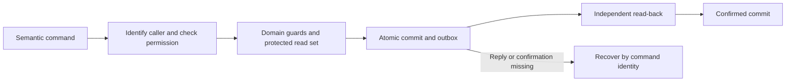

# Commands, storage and recovery

One relational database, SQLite or PostgreSQL, owns an instance's records, history, command results and outbox. Every change uses the same guarded command path. If a caller loses the reply, it asks what happened to that exact command before attempting another change. [Concepts](concepts.md#every-command-ends-in-one-of-four-outcomes) defines the four outcomes every interface must preserve.

## One store owns the durable state

The adopter chooses SQLite or PostgreSQL and supplies the connection; the first vertical will prove PostgreSQL. A store port keeps the application independent of database details; it is not a promise that arbitrary databases can preserve Weave's rules, and each supported database must pass the store's cases below. There is no separate canonical graph, event, history or business store. The kernel answers graph questions over the relational store, and a graph database such as Memgraph enters only if engineering strictly requires it, as a rebuildable view rather than a second home for records. If Twenty is selected as a client or host, it supplies neither Weave's runtime nor the store, and no decision reads a value people can edit there.

Stable identities, definition bindings, record and relation revisions, commands, occurrences, commit receipts and outbox entries use normalised tables. Definition-declared fields use validated JSON, JSONB on PostgreSQL, with declared generated or expression indexes where qualified. This is neither an entity-attribute-value model nor one table per domain.

Object storage, cache, wake notifications, queues, search, clocks, identity, secrets and observability have narrow ports. A cache, queue, index or bounded snapshot can be rebuilt from its owner; it never owns records, history, receipts, permission or causal truth. Such a component may make Weave faster; it may not make Weave's answers depend on it. Redis and BullMQ remain unselected. If introduced, they may supply cache, wake or queue functions, never a second scheduler, command store or causal ledger. Repairing a derived view leaves the authoritative revisions, command result and occurrence intact.

## Every caller uses one write path

Decoding a valid request does not establish permission to execute it. The CLI, REST, MCP, A2A, ACP, external browser clients, scheduled work, permitted bulk operations and privileged services all use the same checks. Each records the actual actor as well as the credential holder. A future import feature would use this path too; importing historical data is not required for the first version.

## A command is a bounded atomic change

One installed operation can change several records and relations within one instance. It declares typed roles and inputs, the finite target set, its reads and required predicates or absences, allowed transitions, deterministic derivations and reactions, read/write/output limits, access rules and result presentation. Clients cannot submit arbitrary transaction scripts.

The application resolves the exact targets and protects expected revisions plus every record, relation, policy, predicate and absence used by the decision until commit. Facts from outside Weave arrive as values gathered before the transaction; the handle the store port gives a decision reaches only this database, as [Concepts](concepts.md#protect-the-decision-through-commit) explains. A blocker added after validation must conflict even if the work record itself did not change. So must permission revoked between validation and commit. A timestamp filter, batch update or one row's revision does not establish that protection. The store implementation must choose and test its locking and isolation mechanism against every mutation route.

Command identity, record changes, history, occurrence, commit receipt data and secret-free outbox are written in one transaction. Independent read-back confirms it before the committing module creates a `CommitReceipt`. A decoded reply supplies a `CommitReport`, not that proof type; [the receipt contract](concepts.md#every-command-ends-in-one-of-four-outcomes) keeps construction private and forbids deserialisation. Anything larger is a resumable sequence of bounded commands, each with its own outcome. Outside effects, object-store writes and other instances' changes happen later under their owners' transactions; see [effects and artifacts](effects.md).

An incoming integration change also binds its acting record and Weave identity, the principal it acts for, any role or proxy delegation, target and operation, permitted field set, outside causal reference, idempotency key, expected revision or operation-specific precondition, conflict policy and expiry. A stale or missing required reference fails before mutation. Only Weave commits; a caller needs its native result and read-back to claim success.

## Recover the original command

Replay identity has two parts. A selector finds the original command: the destination instance, the acting identity, the operation and an opaque command key the caller supplies. A digest of the canonical command must then match it: the targets, inputs, expected revisions, the caller's time constraints and causal references. Transport claims that a retry may refresh, such as expiry, a signature nonce or a tracing identifier, sit outside both, and so does the instant at which Weave evaluated the command. The definition version recorded with the original command governs its replay, so a later activation or retirement cannot make a key name a different command. Two deliberately identical commands carry two keys and remain two commands. A timeout triggers a lookup under that identity, not a newly identified request.

Every outcome is final for its key. An exact replay returns the original result, a refusal included, even if the blocker has since cleared or another permitted command later advanced the record. Changed content under a used key is refused as a reused key and executes nothing; it is not a conflict, because rereading cannot repair a reused key. A caller that tries again after a refusal sends a new command under a new key and references the refused one. This matters most for callers that retry by themselves: a relayed approval redelivered after its blocker cleared, an orchestrator that has already settled an operation as not applied, or another instance repeating a wake. None of them can turn an earlier refusal into a commit nobody made again. Because a refusal holds its key permanently, its record carries references to what was missing rather than copies of the content it judged.

A caller whose access has since been revoked can still replay its own earlier command. It learns only which outcome the command reached (committed, refused, conflicted or unknown), so it does not send the change again, and it receives no record content it can no longer read.

A fault inside Weave before the transaction saves anything is different again. Nothing was decided, so no outcome exists and the key remains unused: the same command can be sent once the fault is fixed, whether it arrived directly or through a scheduled or cross-instance wake. This is not a fifth outcome, and it differs from commit-unknown, where a commit may already have happened. How Weave reports such a fault, so a caller can tell it from commit-unknown, remains design work.

A refusal names the missing condition through the originating surface and leaves the requested record state unchanged. A conflict requires rereading and reconsidering the request. Commit-unknown stays unknown until the original command can be reconciled; it is neither a refusal nor success.

## Outbox entries belong to the commit

Every occurrence a consumer may need is written with the change that produced it. Recovery includes deleted records. Each occurrence preserves actor, trigger and workflow references. The outbox includes:

- Permission, assignment or an attempt accepted for dispatch, before dispatch happens.
- The terminal outcome of a person, tool or other Weave record executing through Weave; this is not a model hosted by the engine.
- Cancellation, recovery and disposition.
- A parent's acceptance or rejection after its current-state checks.
- Ordinary committed changes for which consumers may subscribe.

A delegated case binds an exact existing or newly committed parent transaction. A new parent is its own transaction; configuration and integrations cannot fabricate it. The optional [Pale publisher](../integrations/pale/README.md) sends committed references through Pale's event admission and never writes Pale's journal or causal history.

Six states remain separate: a native commit, a proposed consequence, a permitted consequence, a notification intent, a delivery attempt and the consumer's reconciliation. A failed delivery cannot roll back a comment. Only selected policy creates follow-up work; receiving an event or being able to read it creates no permission.

## Webhooks prompt a read

Signed webhooks are delivered at least once. They carry occurrence and source-position references with minimal safe metadata. An HTTP `2xx` acknowledges delivery only. Consumers recover gaps through a cursor feed and authorised read-back, retaining the producer's incarnation and ordering rather than inventing a new event on retry.

An occurrence is identified by origin instance, incarnation or producer epoch, and immutable occurrence ID. A canonical content digest binds its bytes. Reusing the coordinate with changed bytes fails. Ordinary HTTP retry keys cannot replace it. The same identity applies to [exchange between instances](instances.md).

A wake-up is a request to reconcile. Its payload is not the current record. Read-back produces a revision-bound view; any resulting consumer action needs that consumer's permission and result. A child result similarly supplies evidence for a fresh parent decision rather than accepting the parent itself.

## Work, attempts and budgets have separate histories

A domain chooses work states such as scheduled, waiting, active, submitted, rework, review and resolved. How work ended is separate from whether it succeeded. Where policy permits only one active attempt, the implementation must enforce an exact reservation and fence, updating reservation and usage under concurrency control.

Handing over unstarted work differs from transfer during an active attempt. Completed work retains its original actor and acceptance. Work budgets grant no spending permission, replace no source transaction and do not duplicate an orchestrator's execution budgets. Cancellation fences future action; an effect already in flight requires the provider's read-back and, where needed, a separately permitted compensation.

## Pruning lets the system improve instead of accumulating

In Weave's design, pruning is a critical part of the graph that evolves beneath the whole Pale ecosystem, and it happens at run time: what to prune, what not to prune, how to decide and when to act. Without it the system does not improve; it only accumulates, and every burst, the sudden run of reads and writes a swarm of agents produces, leaves more for the dependency walk, the traversal of what a read or write depends on, to cross. Pruning is the counterweight to keeping every decision. Weave never deletes an owner's copied content on its own initiative ([concepts](concepts.md#records)). Which objects pruning may remove, and by what test, is still being decided.

## Prove recovery before storing valuable data

A working database connection or a successful write does not show that an instance can recover its records, history, commit receipts and pending effects together, so an instance should hold nothing valuable until that recovery has been demonstrated.

The store must pass guarded-command and read-set concurrency cases, atomic outbox checks, independent read-back, complete-instance backup and restore, definition-pinned schema evolution, decommissioning and unknown-effect recovery. The relational store alone must preserve schedules, events, outbox rows, idempotency and the concurrency facts needed to recover without an outside queue.

Review permissions, locks and constraints at the actual store boundary, rehearse changes on disposable data, and confirm the result independently. Release, deployment, admission by an orchestrator and activation are separate lifecycles. An unsupported downgrade requires a tested restore or reviewed forward repair, never a claimed rollback that cannot restore the state. Initial records are fresh native data.
